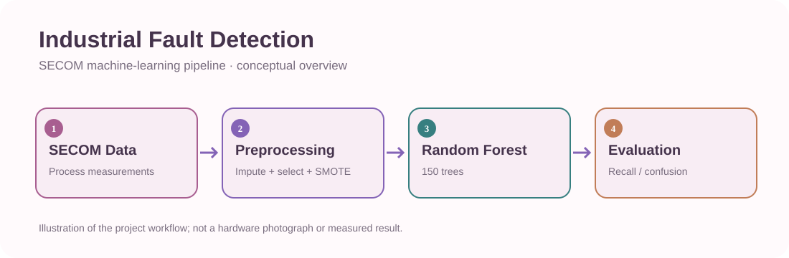

# Industrial Fault Detection with Machine Learning (SECOM)

An educational supervised-learning case study using semiconductor manufacturing measurements from the [UCI SECOM dataset](https://archive.ics.uci.edu/dataset/179/secom).

## Visual overview



*Conceptual pipeline diagram.* The script produces evaluation figures when run with the UCI SECOM dataset. Do not present those charts as validated results until they have been reproduced.


## Method
- Read numerical measurements and binary pass/fail labels.
- Remove feature columns with more than 90% missing data.
- Impute missing values using medians and select 40 features with ANOVA F-scores.
- Address class imbalance using SMOTE in the pipeline.
- Train a Random Forest with 150 trees.
- Evaluate with 10-fold cross-validation, a stratified test split, classification metrics, a confusion matrix, ROC curve and feature importances.

## Limitations
A previous coursework report described high overall accuracy but low recall on the failure class; accuracy alone is unsuitable for assessing rare fault detection. The training/evaluation results have **not been independently reproduced** for this publication. This is not a validated production monitoring tool.

## Data
Download the SECOM dataset from UCI and save:
```
data/secom.data
data/secom_labels.data
```
Third-party datasets are excluded from this repository.

## Run
```bash
python -m venv .venv
pip install -r requirements.txt
python src/secom_fault_detection.py
```

The publication version replaces hard-coded local Windows paths with relative paths and fixes selected-feature importance labels. Further work should emphasize failure recall, precision, PR-AUC, false-negative costs and comparison of models.

## Skills
Python · Scikit-learn · Random Forest · Feature Selection · SMOTE · Imbalanced Classification
